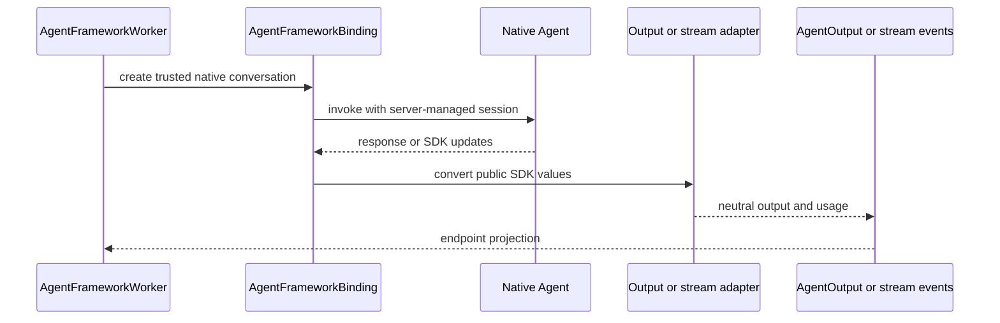

# Microsoft Agent Framework integration

The `ygo74-agent-runtime-agentframework` distribution adapts an existing
Microsoft Agent Framework agent. It does not build an agent from manifests or
own its domain tools. Keep its optional SDK dependency in this distribution.

## Output and session flow

`AgentFrameworkOutputAdapter` and `AgentFrameworkStreamAdapter` handle SDK
conversion. `AgentFrameworkSession` retains native session state. The bounded
approval loop handles repeated framework suspensions, while the application
resolver decides whether an operation needs a person. `AgentFrameworkWorker`
binds the native factory to the managed worker and performs deterministic tool
admission.

Do not serialize arbitrary SDK objects or expose tool arguments/results as
answer text. Preserve unknown usage as unknown. On failure or cancellation,
finalize the stream as incomplete and invalidate unhealthy session state.

Source: [`integrations/agentframework`](../../packages/python/agentframework/ygo74/agent_runtime/integrations/agentframework/).
Tests: [binding](../../tests/integration/python/test_agentframework_binding.py),
[output adapter](../../tests/integration/python/test_agentframework_output_adapter.py),
and [native worker](../../tests/integration/python/test_native_worker.py).

See the [Agent Framework specification](../../spec/integrations/agent-framework.md)
and [public guide](../../docs/python/agentframework.md).
