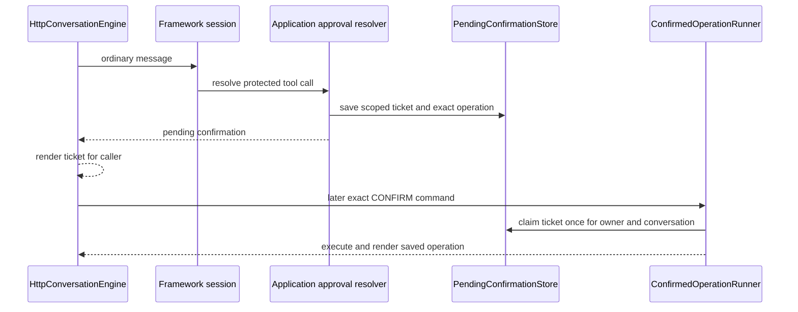
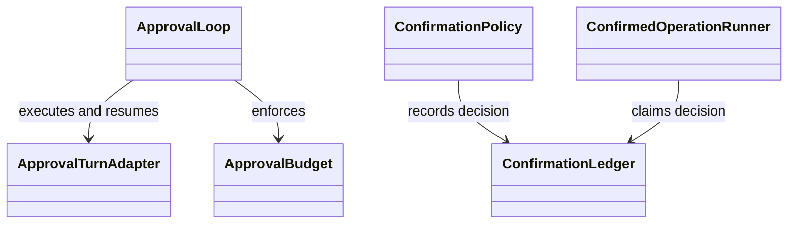

# Human approval

Approval contains two related paths. A confirmation ticket carries a protected
operation between HTTP turns. `ApprovalLoop` resumes framework-level
interruptions within one invocation. Applications own the human-facing policy
and resolver; the runtime owns reusable parsing, ticket, gate, and bounded-loop
mechanics.

## Ticket path

`ConfirmationPolicy` classifies operations. `ConfirmationLedger` binds an
authorization decision to the operation details, and the gate checks that
decision at execution time. Confirmation commands are parsed before another
model turn. Keep user-facing ticket details in the application presenter.

## Framework interruption path

`ApprovalLoop` processes an ordered batch of pending calls through an
`ApprovalTurnAdapter`. `ApprovalBudget` limits approval questions and total
turns. If a limit is reached, it clears recorded grants and attempts bounded
decline cleanup. Cleanup failure must not resume an action as approved.

Implementation: [`domains/humanapproval`](../../packages/python/agents/ygo74/agent_runtime/domains/humanapproval/).
Tests: [bounded approval loop](../../tests/integration/python/test_approval_loop.py),
[confirmation behavior](../../tests/integration/python/test_human_approval.py),
and [gated operations](../../tests/integration/python/test_gated_operations.py).

See the [human approval specification](../../spec/runtime/human-approval.md).
