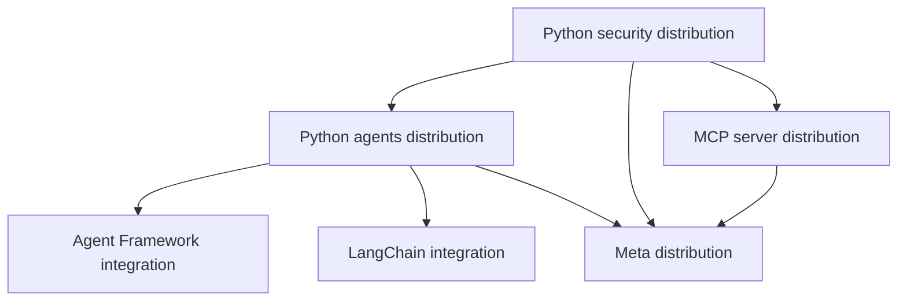
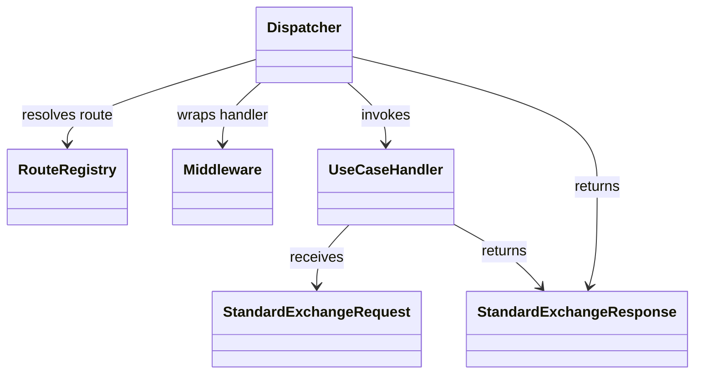

# Architecture and package boundaries

## Package layout

The repository has three language implementations. Python is split into
installable distributions so consumers can install only the features they use.
The `.NET` and Java packages currently implement the shared exchange and
endpoint core. Python also contains agent, security, configuration, framework,
conversation, approval, and MCP APIs.

Framework SDKs stay in optional integration distributions. FastAPI, MCP SDK,
configuration libraries, and model SDKs are optional extras where the package
metadata defines them. Keep import-time dependencies inside the domain that
needs them.

## Cross-language core

The main implementation areas are:

| Responsibility | Python | .NET | Java |
|---|---|---|---|
| Exchange contracts | `domains/contracts` | `Domains/Contracts` | `domains/contracts` |
| Endpoint mapping | `domains/mapping`, `domains/endpoints` | `Domains/Mapping`, `Domains/Endpoints` | `domains/mapping`, `domains/endpoints` |
| Routing | `routing` | `Routing` | `routing` |
| Middleware | `middleware` | `Middleware` | `middleware` |
| Authentication | `domains/auth` in security distribution | `Domains/Auth` | `domains/auth` |
| Logging and telemetry | `observability` | `Observability` | `observability` |

Parity is defined by implemented behavior, not by matching directory names.
Use the [language status](../../spec/compatibility/language-status.md) when
deciding whether a Python-only API belongs in the shared contract.

## Public API and extensions

Python code is imported from domain modules under
`ygo74.agent_runtime.domains`; the former root-level facade is not supported.
Package `PublicApi` files expose the supported .NET and Java entry points.
Framework integrations adapt existing native agents. They do not create a
framework-neutral agent abstraction.

See [component ownership](../../spec/architecture/component-model.md) for the
full boundary map. Package declarations are in the Python `pyproject.toml`
files, `.NET` project file, and Java `pom.xml`.
