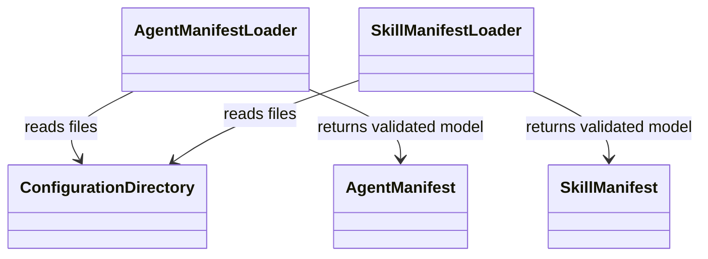
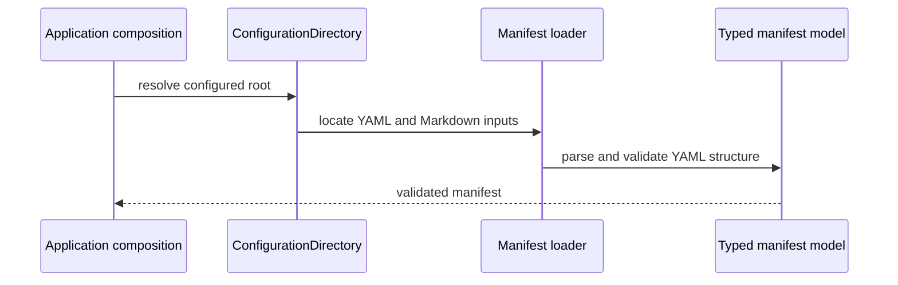

# Delivered configuration

The optional `configuration` extra owns configuration-directory resolution,
`.env` loading, typed `agent.yaml` and `skill.yaml` models, and packaged JSON
Schemas. The `ConfigurationDirectory` is passed to the loaders so applications
can select an explicit root. Agent and skill Markdown instructions are loaded
as separate inputs; they are not validated by the YAML schemas.

Keep unknown-field rejection and schema identifiers in sync with typed models.
Semantic checks, such as matching a permission to an application's
`PermissionRegistry` or enforcing its security floor, remain outside structural
schema validation.

Source: [`domains/configuration`](../../packages/python/agents/ygo74/agent_runtime/domains/configuration/).
Tests: [manifest configuration schemas](../../tests/integration/python/test_manifest_configuration_schemas.py)
and [descriptor validation](../../tests/integration/python/test_descriptor_validation.py).

See the [manifest specification](../../spec/configuration/agent-manifests.md)
and [Python configuration guide](../../doc/python/README.md).
