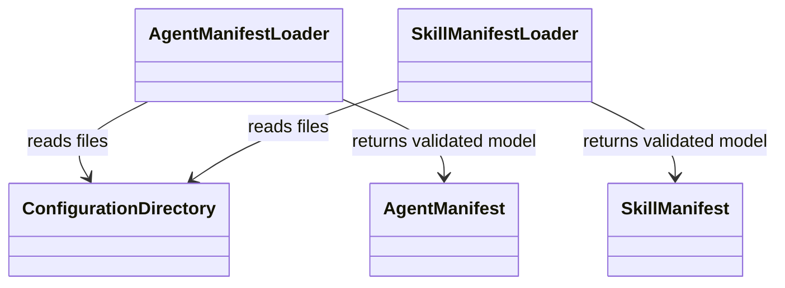
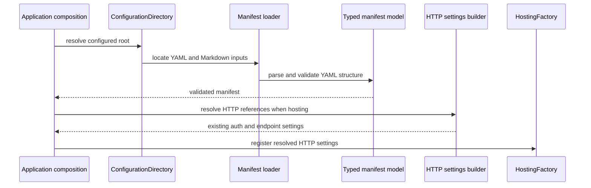

# Delivered configuration

The optional `configuration` extra owns configuration-directory resolution,
`.env` loading, typed `agent.yaml` and `skill.yaml` models, and packaged JSON
Schemas. The `ConfigurationDirectory` is passed to the loaders so applications
can select an explicit root. Agent and skill Markdown instructions are loaded
as separate inputs; they are not validated by the YAML schemas.

`agent.yaml` may also declare optional FastAPI `http` settings: selected
invocation endpoints, exactly one JWT or API-key policy, and optional rate
limits. The manifest model stores secret references as protected values and
does not resolve them during CLI/MCP loading. The composition root resolves
them with `AgentHttpSettingsBuilder` before handing the result to
`HostingFactory.add_http_settings()`.

Keep the stages separate: validate the HTTP declaration with the manifest,
resolve protected environment references only when constructing the HTTP host,
then pass the resulting route, authentication, and rate-limit settings to the
hosting factory. Do not duplicate JWT/API-key policy construction in endpoint
registration. HTTP settings cannot be combined with separately selected routes
or authentication. The optional `http` extra supplies FastAPI, SlowAPI, and
Redis; SlowAPI is imported only when limits are configured.

The [Python agent manifest reference](../python/agent-manifest.md) documents
all `agent.yaml` keys and value types, including the HTTP settings, and shows
how developers can enable the packaged schema in VS Code.

Keep unknown-field rejection and schema identifiers in sync with typed models.
Semantic checks, such as matching a permission to an application's
`PermissionRegistry` or enforcing its security floor, remain outside structural
schema validation.

Source: [`domains/configuration`](../../packages/python/agents/ygo74/agent_runtime/domains/configuration/)
and [`http_configuration.py`](../../packages/python/agents/ygo74/agent_runtime/domains/contracts/http_configuration.py).
Tests: [manifest configuration schemas](../../tests/integration/python/test_manifest_configuration_schemas.py),
[HTTP manifest configuration](../../tests/integration/python/test_agent_http_configuration.py),
[HTTP hosting integration](../../tests/integration/python/test_manifest_http_hosting.py),
and [descriptor validation](../../tests/integration/python/test_descriptor_validation.py).

See the [manifest specification](../../spec/configuration/agent-manifests.md)
and [Python configuration guide](../../doc/python/README.md).
