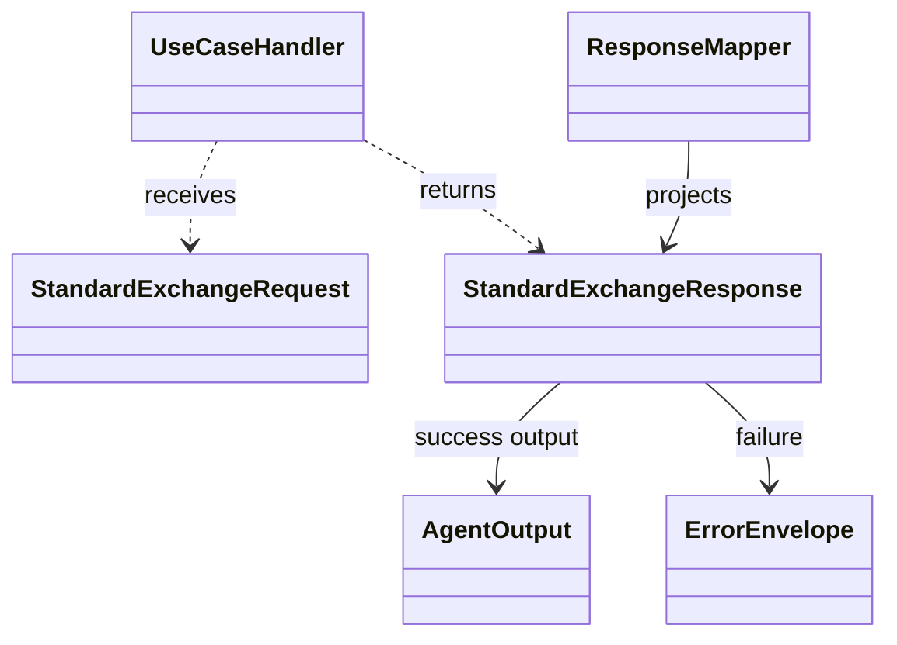
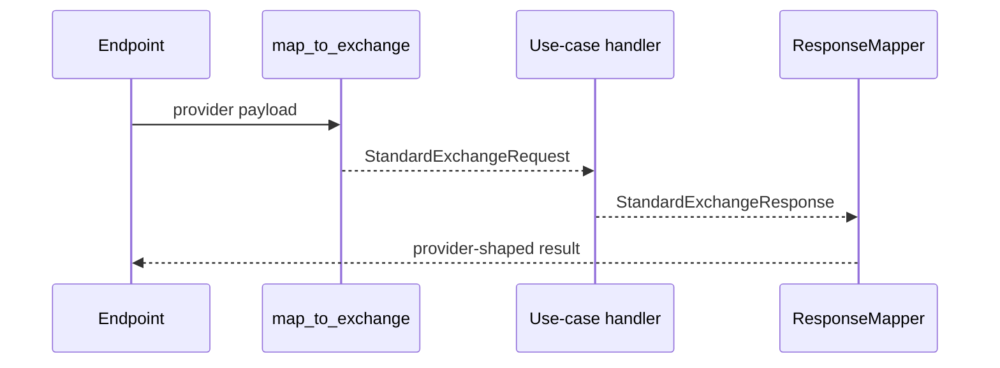

# Contracts and mapping

## Exchange contract

Endpoint adapters convert provider requests into `StandardExchangeRequest`.
Handlers receive that neutral request and return `StandardExchangeResponse`.
The response mapper projects the result into the selected provider shape.
`request_id`, route key, safe metadata, and authentication context cross the
exchange boundary explicitly.

Python typed agent output is defined separately from the cross-language
exchange models. It represents text, structured JSON, media, citations, tool
information, usage, and termination state without exposing SDK objects. Keep
that provider-neutral model independent of LangChain and Agent Framework.

## Change workflow

When changing a public field or serialization rule:

1. Update the typed model and its serializer or mapper.
2. Update the applicable schema or machine-readable contract under
   `specs/001-openai-endpoint-exposure/contracts/`.
3. Update the language implementations that promise the same contract.
4. Update contract tests and endpoint projections.
5. Update the relevant page under `spec/` and consumer docs when behavior is
   externally visible.

Python source: [`exchange_models.py`](../../packages/python/agents/ygo74/agent_runtime/domains/contracts/exchange_models.py),
[`agent_output.py`](../../packages/python/agents/ygo74/agent_runtime/domains/contracts/agent_output.py),
and [`output_serialization.py`](../../packages/python/agents/ygo74/agent_runtime/domains/contracts/output_serialization.py).
The .NET and Java exchange models are under their `Domains/Contracts` and
`domains/contracts` packages.

## Verification sources

- [Standard exchange contract tests](../../tests/contract/test_standard_exchange_schema.py)
- [Agent output contract tests](../../tests/contract/test_agent_output.py)
- [Agent output v2 schema tests](../../tests/contract/test_agent_output_v2_schema.py)
- [Cross-language exchange parity](../../tests/parity/test_exchange_parity.py)
- [Exchange contract specification](../../spec/contracts/exchange-contract.md)
- [Typed output specification](../../spec/contracts/agent-output-and-streaming.md)
