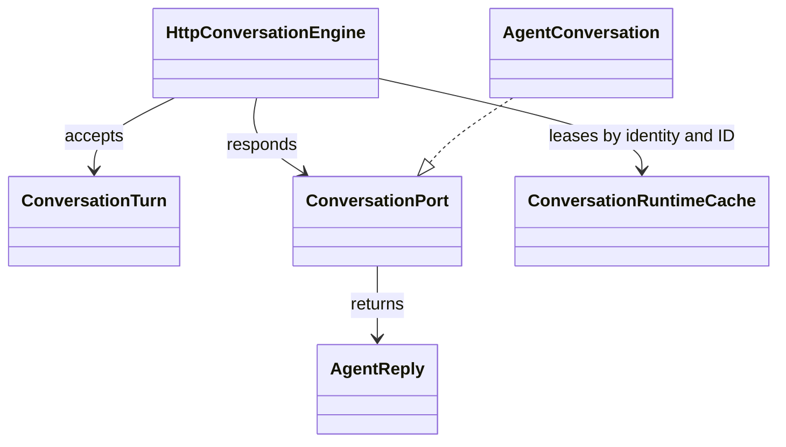

# Conversations and cache lifecycle

## Conversation contracts

`ConversationTurn`, `AgentReply`, and `ConversationEngine` define the HTTP-facing
conversation contract. `AgentConversation` groups a runtime, a framework
session, and optional confirmation collaborators. `HttpConversationEngine`
leases the conversation, handles exact confirmation commands before invoking
the session, and assembles a reply.

## Cache and resource ownership

`ConversationRuntimeCache` partitions entries by identity namespace, verified
subject, and conversation ID. An acquired lease keeps an active turn's resources
alive. Idle entries may expire or be evicted; close callbacks run after active
leases finish. Shutdown drains and closes entries. The cache is process-local;
it is not durable state or a cross-worker coordinator.

Applications provide the conversation factory and close behavior. Framework
sessions own framework state; the cache owns reuse and lifecycle only. On
failed or cancelled native turns, adapters should invalidate unhealthy state
through their conversation/session close path.

Source: [`agent_conversation.py`](../../packages/python/agents/ygo74/agent_runtime/domains/sessions/agent_conversation.py),
[`conversation_cache.py`](../../packages/python/agents/ygo74/agent_runtime/domains/sessions/conversation_cache.py),
and [`conversation_entrypoint.py`](../../packages/python/agents/ygo74/agent_runtime/domains/endpoints/conversation_entrypoint.py).
Tests: [conversation port](../../tests/integration/python/test_agent_conversation.py),
[cache lifecycle](../../tests/integration/python/test_conversation_cache.py),
and [serialized lifecycle](../../tests/integration/python/test_serialized_conversation_lifecycle.py).

See the [pipeline and state specification](../../spec/runtime/pipelines-and-state.md)
and [managed worker specification](../../spec/endpoints/managed-agent-worker.md).
