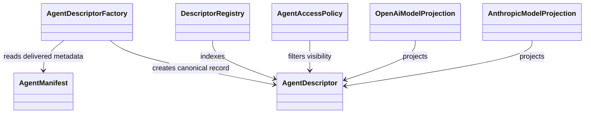
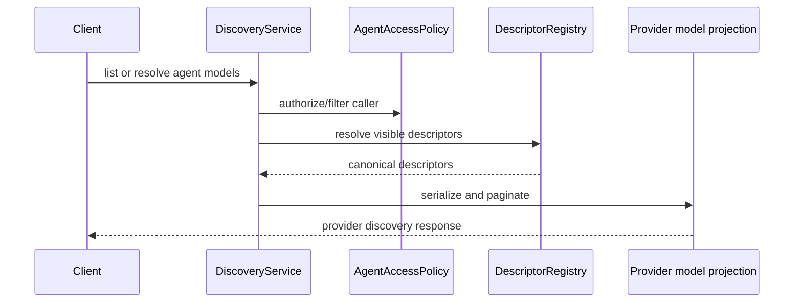

# Agent discovery

## Descriptor pipeline

Discovery describes agents that are already composed by an application.
`AgentDescriptorFactory` projects a validated manifest and deployment facts
into the canonical `AgentDescriptor`. `DescriptorRegistry` indexes descriptors
by public ID and route key. OpenAI and Anthropic projections serialize that
record into their respective discovery surfaces.

The descriptor is the source for identity, capabilities, skills, security
schemes, and extensions. Keep provider models as projections; do not maintain a
second provider-specific catalog. Advertised security must match the
authenticators configured on the host.

## Discovery request flow

Application composition supplies identity, authorization policy, dialect
selection, and pagination settings. Discovery code handles the common
registry/projection mechanics and typed errors.

Source: [`domains/discovery`](../../packages/python/agents/ygo74/agent_runtime/domains/discovery/).
Tests: [discovery round trip](../../tests/integration/python/test_discovery_round_trip.py),
[identifier matching](../../tests/integration/python/test_discovery_identifier_matching.py),
[pagination](../../tests/integration/python/test_discovery_pagination.py),
and [model discovery endpoints](../../tests/integration/python/test_model_discovery_endpoints.py).

See the [agent catalog specification](../../spec/discovery/agent-catalog.md).
