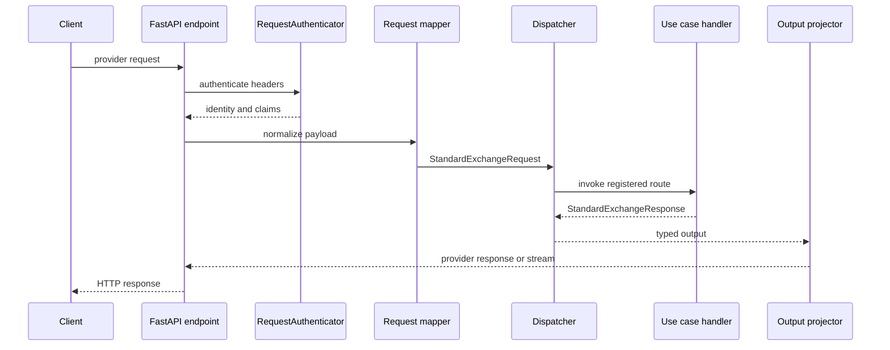
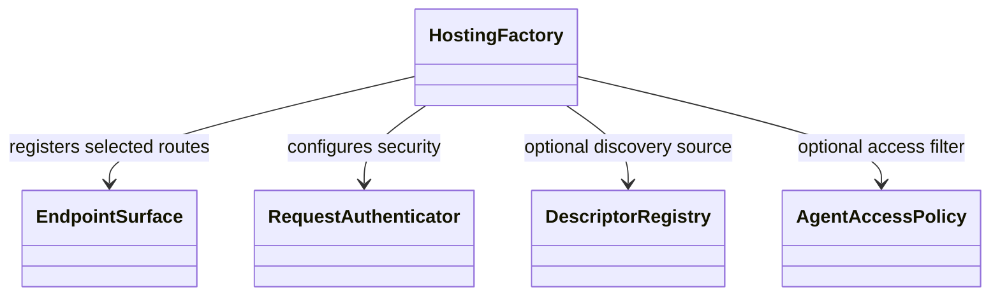

# Endpoints and streaming

## Request path

The Python FastAPI surface owns protocol validation and response rendering. It
authenticates the request, normalizes its payload, selects the route, calls the
configured entrypoint, then maps the result back to the provider protocol.
`HostingFactory` provides a typed composition API around these endpoint
functions; the lower-level `add_ai_endpoints` remains the registration layer.

The Python surface supports configured OpenAI Responses, OpenAI Chat
Completions, and Anthropic Messages endpoints. Optional discovery shares the
descriptor registry but applies the configured access policy to both model
invocation and discovery results.

## Streaming

Handlers return typed stream events. A `StreamProcessor` coordinates event
state and provider projectors render SSE frames. The projector must close open
content and produce one terminal event. Errors and client cancellation use
failure or cancellation termination; they must not be reported as success.
Keep provider-specific event rules in `domains/streaming` and neutral event
types in `domains/contracts/stream_events.py`.

## Extension points

- Add or adjust an endpoint adapter when a provider has a different request or
  response shape.
- Add a projector for provider-specific output or stream rules.
- Use `RequestHeaderForwarder` only for explicitly allowed application
  headers; credential headers are excluded.
- Add a surface to `HostingFactory` when it can reuse the existing route and
  authentication lifecycle.

Python source is under [`domains/endpoints`](../../packages/python/agents/ygo74/agent_runtime/domains/endpoints/),
[`domains/mapping`](../../packages/python/agents/ygo74/agent_runtime/domains/mapping/),
and [`domains/streaming`](../../packages/python/agents/ygo74/agent_runtime/domains/streaming/).
Relevant tests include [non-stream endpoints](../../tests/integration/python/test_non_stream_endpoints.py),
[streaming endpoints](../../tests/integration/python/test_streaming_endpoints.py),
[Responses API](../../tests/integration/python/test_openai_responses_api.py),
and endpoint tests under `tests/integration/dotnet/` and
`tests/integration/java/`.

See the [provider surfaces specification](../../spec/endpoints/provider-surfaces.md)
and [managed worker specification](../../spec/endpoints/managed-agent-worker.md).
