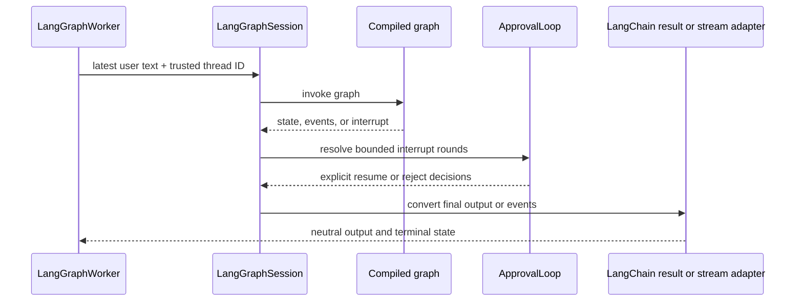

# LangChain and LangGraph integration

The `ygo74-agent-runtime-langchain` distribution adapts public LangChain result
and event APIs and can run an existing LangGraph as a server-managed
conversation. It does not construct the graph, choose tools, or authorize
application operations. FastAPI remains optional for worker hosting.

## Graph turn flow

The session sends only the latest user text. The caller or worker must derive
the checkpoint `thread_id` from trusted identity and conversation context.
The adapter selects a supported assistant message; it must not stringify an
arbitrary graph state. Streams close their producer on completion, error, or
cancellation. A failed or abandoned turn must not leave reusable healthy state.

Application code supplies interrupt policy and required tool-admission hooks.
Declarations describe tool surface; they do not authorize execution.

Source: [`integrations/langchain`](../../packages/python/langchain/ygo74/agent_runtime/integrations/langchain/).
Tests: [LangChain adapter packaging](../../tests/integration/python/test_langchain_adapter_packaging.py),
[output adapter](../../tests/integration/python/test_langchain_output_adapter.py),
[LangGraph binding](../../tests/integration/python/test_langgraph_binding.py),
and [LangGraph worker](../../tests/integration/python/test_langgraph_worker.py).

See the [LangChain/LangGraph specification](../../spec/integrations/langchain-langgraph.md)
and [public guide](../../doc/python/langchain.md).
