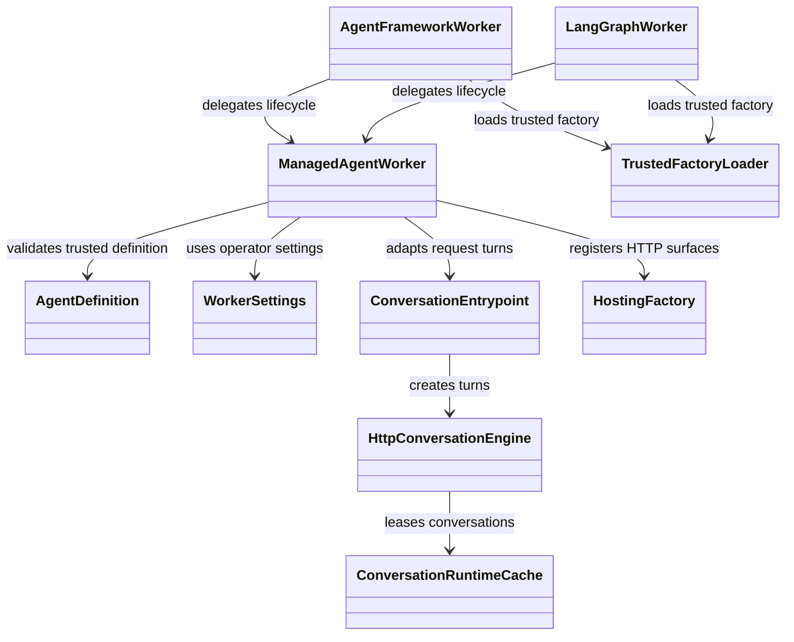
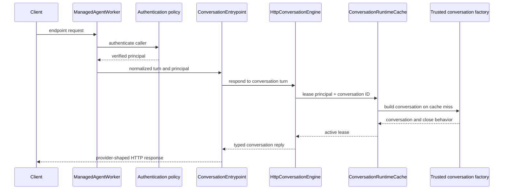

# Managed native-agent worker

`ManagedAgentWorker` hosts an existing native agent behind runtime endpoints.
It owns authentication enforcement, the process-local conversation cache,
timeouts, readiness, and graceful resource cleanup. It does not construct the
native agent, model, tools, or domain authorization policy.

## Request lifecycle

The framework workers use `TrustedFactoryLoader` to load an
`AgentDefinition.factory` selected by deployment configuration; request data
cannot choose that module. The core worker requires explicit authentication
and identity namespace. Cache defaults and turn timeout live in
`WorkerSettings`; state is local to one process. Framework bindings add their
own tool-admission checks.

Source: [`managed_worker.py`](../../packages/python/agents/ygo74/agent_runtime/domains/endpoints/managed_worker.py)
and [`agent_definition.py`](../../packages/python/agents/ygo74/agent_runtime/domains/contracts/agent_definition.py).
Tests: [native agent definition](../../tests/integration/python/test_native_agent_definition.py)
and [native worker](../../tests/integration/python/test_native_worker.py).

See the [managed worker specification](../../spec/endpoints/managed-agent-worker.md)
and [native agent guide](../../docs/python/native-agents.md).
