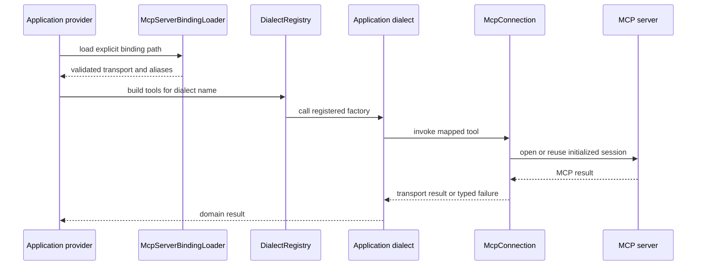
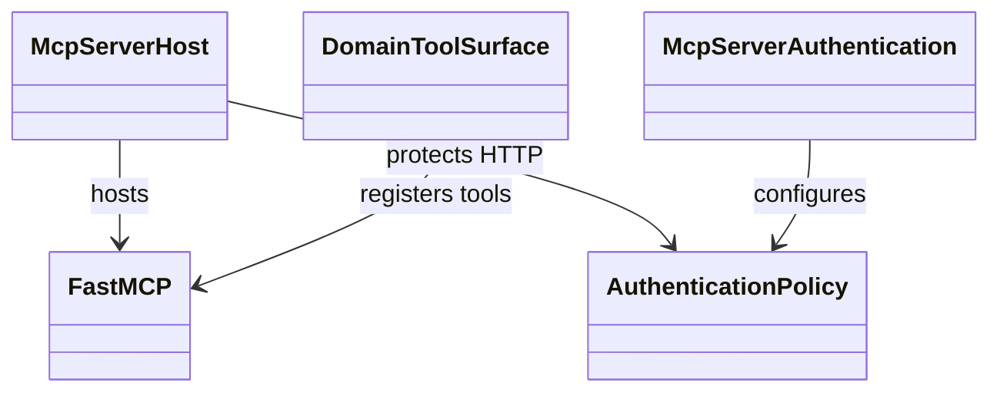

# MCP client and server hosting

The runtime splits MCP client and server hosting into optional Python
distributions. The agents package provides binding, connection, dialect
selection, and OAuth client helpers. The MCP server package provides shared
streamable-HTTP hosting and authentication. Neither package owns application
tool semantics.

## Client call path

The application selects capability enums, credentials, HTTP headers, and
concrete dialects. It also filters capabilities before advertising tools.
`McpConnection` handles stdio or streamable HTTP lifecycle and translates
transport errors. Header values are redacted from representations and logs.

## Server host

`McpServerHost` wraps an application MCP server with shared streamable-HTTP
authentication, health, and optional OAuth protected-resource metadata. Tool
registration and source-system authorization stay with the server application.
Stdio hosting does not require the HTTP extra.

Client source is in [`domains/mcp`](../../packages/python/agents/ygo74/agent_runtime/domains/mcp/).
Server source is in [`domains/mcpserver`](../../packages/python/mcpserver/ygo74/agent_runtime/domains/mcpserver/).
Tests: [MCP plumbing](../../tests/integration/python/test_mcp_plumbing.py),
[MCP server hosting](../../tests/integration/python/test_mcp_server_hosting.py),
and [MCP server settings](../../tests/integration/python/test_mcp_server_settings.py).

See the [MCP specification](../../spec/mcp/client-and-server.md) and [server
hosting guide](../../docs/mcp-server-hosting.md).
