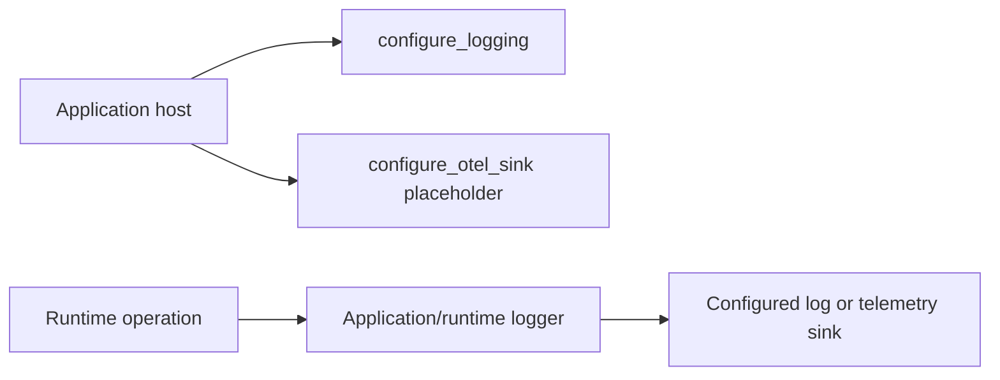

# Observability

Observability is a supporting domain, not part of the request contract.
`configure_logging` sets the runtime's logging defaults. `configure_otel_sink`
is currently a placeholder: it returns the supplied exporter setting but does
not install an OpenTelemetry pipeline. The .NET helper also returns its input.
Application hosts still own exporters, resource attributes, and deployment
logging policy.

Do not log credentials, authorization headers, request bodies, or raw provider
errors. Domain-specific safe identifiers belong in structured fields. Keep
logging configuration callable more than once so test and application hosts
can set their own logging configuration. Do not document the telemetry helper
as an exporter until its implementation actually installs one.

Python source: [`observability`](../../packages/python/agents/ygo74/agent_runtime/observability/).
Cross-language setup is under `packages/dotnet/.../Observability` and
`packages/java/.../observability`. Tests: [Python reconfiguration](../../tests/integration/python/test_observability_reconfiguration.py),
[.NET reconfiguration](../../tests/integration/dotnet/ObservabilityReconfigurationTests.cs),
and [Java reconfiguration](../../tests/integration/java/ObservabilityReconfigurationTest.java).

See [observability specification](../../spec/operations/observability.md).
