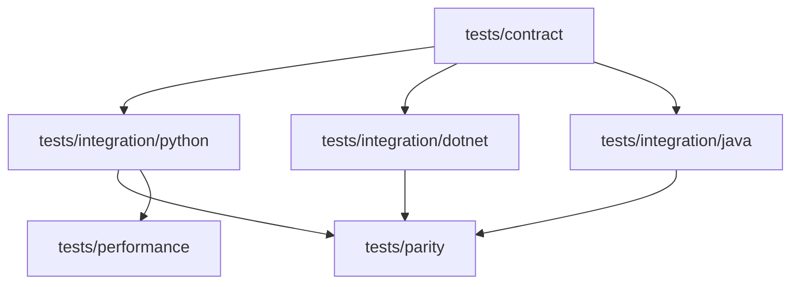

# Language parity and validation

## Parity boundary

The shared cross-language core centers on exchange models, endpoint mapping,
routing, middleware, authentication, configuration, and observability. Agent
output contracts, discovery, typed manifests, reasoning, application security,
conversation sessions, bounded approval, framework bindings, and MCP support
are currently Python APIs. Do not describe a Python-only feature as shared just
because it uses a provider-neutral name.

The source of truth for implemented status is the
[language status specification](../../spec/compatibility/language-status.md).
Cross-language changes should update parity notes and matching contract tests
in the same change.

## Validation layout

Contract tests pin schemas and protocol behavior. Integration tests exercise a
language implementation. Parity tests compare shared behavior. Performance
tests use their own budgets and baselines. Follow `AGENTS.md` and the active
feature plan for the required quality gates; this page does not replace them.

Useful entry points: [`tests/contract`](../../tests/contract/),
[`tests/parity`](../../tests/parity/),
[`tests/integration`](../../tests/integration/), and
[`tests/performance`](../../tests/performance/).
