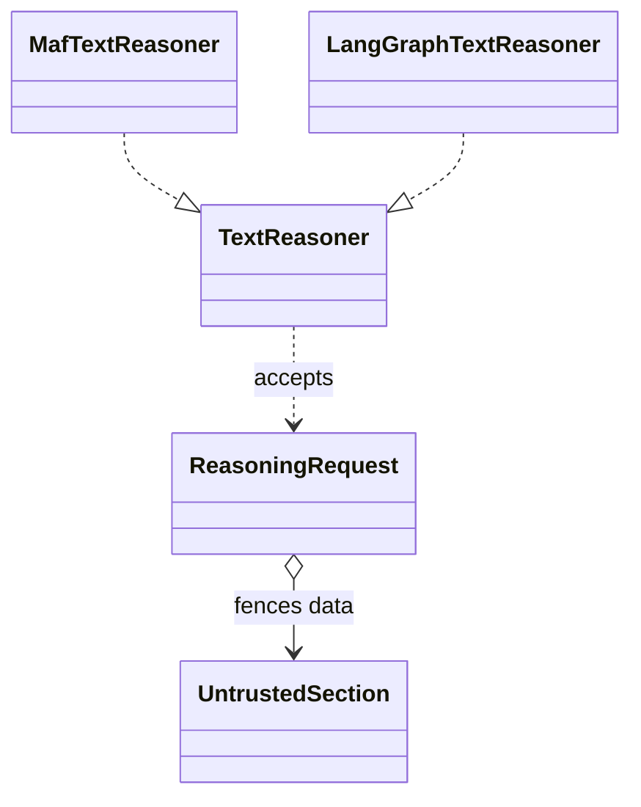
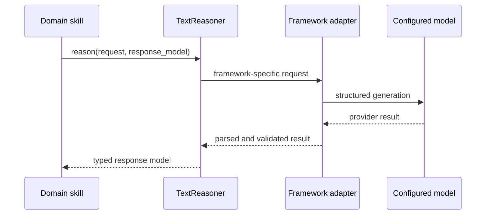

# Framework-neutral reasoning

`TextReasoner` is the Python port for model-backed, typed reasoning. A caller
provides a `ReasoningRequest` and a Pydantic response model; the implementation
returns a validated instance of that model. The port does not select a model,
manage credentials, or contain framework SDK types.

Applications construct the request with trusted instructions and labelled
untrusted sections. The framework adapter sends it to its native model client,
parses structured output, and translates provider failures into the runtime
reasoning error hierarchy. Keep output schemas and domain interpretation in
the application that owns the result type.

Source: [`ports.py`](../../packages/python/agents/ygo74/agent_runtime/domains/reasoning/ports.py).
Application implementations live with their framework adapters; the runtime
integration boundaries are described in the [Agent Framework page](../../spec/integrations/agent-framework.md)
and [LangChain/LangGraph page](../../spec/integrations/langchain-langgraph.md).
The prompt-data contract is covered by
[untrusted content tests](../../tests/integration/python/test_untrusted_content.py).

See the [reasoning specification](../../spec/runtime/reasoning.md).
