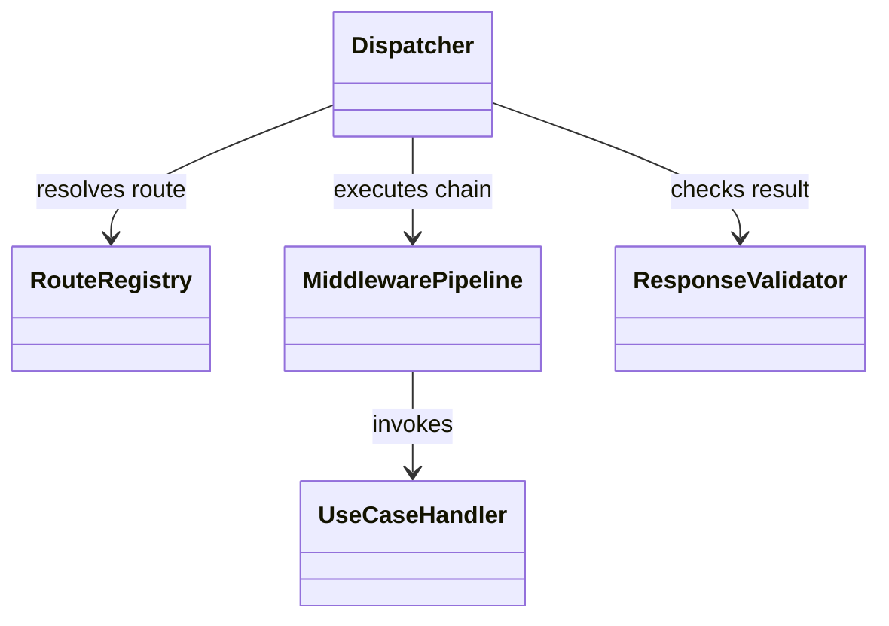
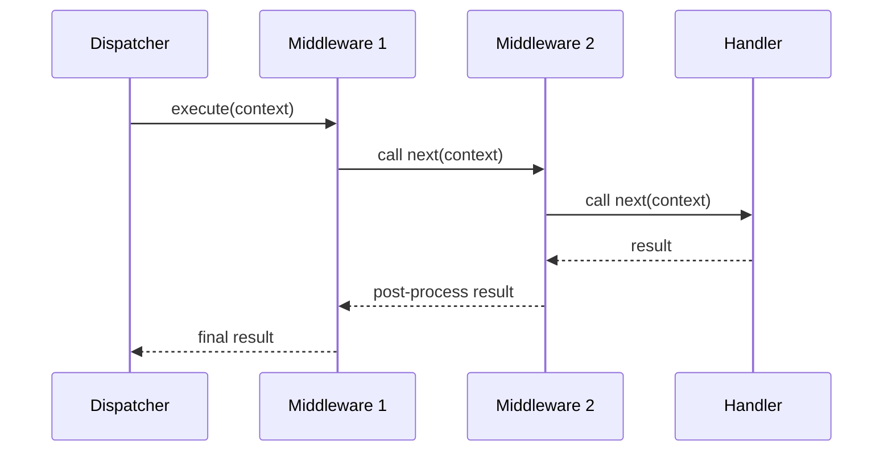

# Routing and middleware

## Routing

`RouteRegistry` stores handlers by route key. `Dispatcher` resolves the key,
validates the handler outcome, and runs the selected handler through the
middleware pipeline. Missing keys and invalid outcomes use typed domain errors
and are mapped at the endpoint boundary.

Routes are explicit configuration. Do not infer a route from model text or
silently substitute a default handler after an unknown explicit route.

## Middleware order

Middleware wraps a continuation. Registration order determines nesting and
therefore request/response order. A middleware may inspect or replace a context,
call the next item, or short-circuit. Middleware errors are mapped to the
standard error contract by the dispatcher or endpoint layer.

The Python APIs are under [`routing`](../../packages/python/agents/ygo74/agent_runtime/routing/)
and [`middleware`](../../packages/python/agents/ygo74/agent_runtime/middleware/).
Equivalent implementations are under the .NET and Java package roots.

Tests: [dispatch routing](../../tests/integration/python/test_dispatch_routing.py),
[middleware pipeline](../../tests/integration/python/test_middleware_pipeline.py),
and [middleware short-circuit](../../tests/integration/python/test_middleware_short_circuit.py).
