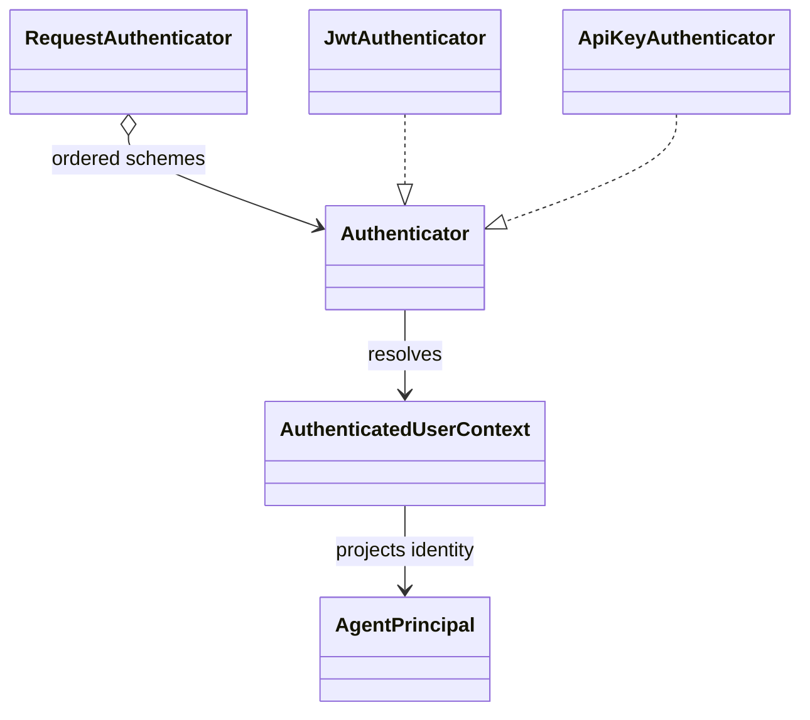
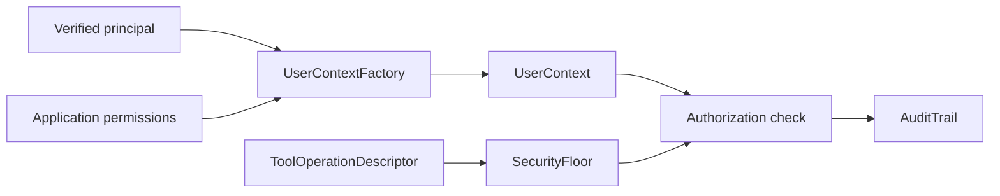

# Authentication and application security

## Authentication boundary

Authenticators turn request credentials into an `AuthenticatedUserContext`.
The context separates identity data from application permissions. Endpoint
handlers receive a verified identity only when authentication is configured;
the host chooses whether authentication is required and which schemes are
accepted.

The security distribution owns shared authentication and application-security
primitives. Keep framework-specific request extraction in the endpoint or MCP
host package. Credential values must not enter logs, prompts, or `UserContext`.

## Application security primitives

Python-only domain primitives include `PermissionRegistry`, `UserContext`,
`OperationClassifier`, `SecurityFloor`, audit events, and `UntrustedText`.
These types express application decisions; authentication does not grant an
operation permission. A prompt fence labels untrusted content but is not a
substitute for deterministic authorization.

Python sources are in [`packages/python/security`](../../packages/python/security/)
and include both the authentication and application-security domains.
Cross-language auth classes are in `packages/dotnet/.../Domains/Auth` and
`packages/java/.../domains/auth`.

Relevant tests: [authentication policy](../../tests/integration/python/test_authentication_policy.py),
[permission denials](../../tests/integration/python/test_authorization_denial.py),
[security posture](../../tests/integration/python/test_security_posture.py),
and [untrusted content](../../tests/integration/python/test_untrusted_content.py).

See the [authentication specification](../../spec/security/authentication-and-authorization.md)
and [application security specification](../../spec/security/application-security-primitives.md).
